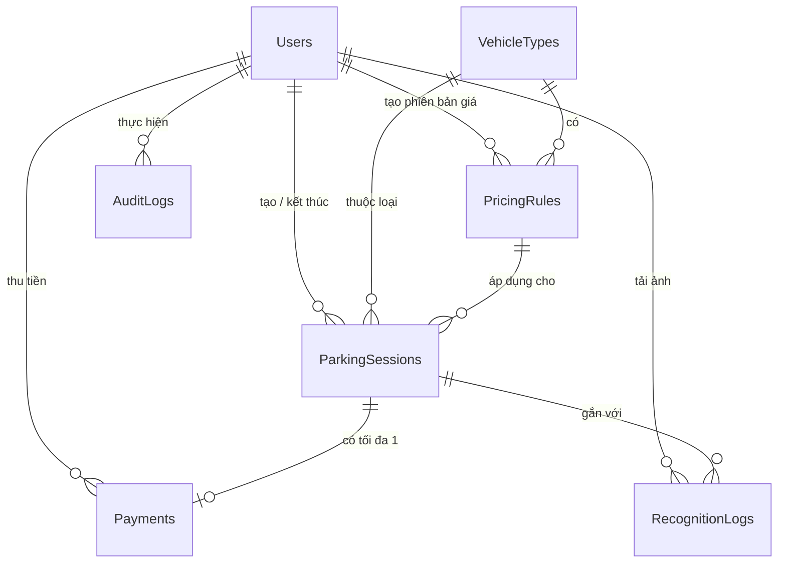

# Giai đoạn 2 — Thiết kế hệ thống

**Đề tài:** Xây dựng ứng dụng quản lý xe ra vào và tính phí gửi xe bằng nhận diện biển số
**Trạng thái:** ĐÃ XÁC NHẬN (27/10/2026) — quy tắc phí ở mục 4 đã được nhóm chốt cho giai đoạn phát triển.
**Ngày:** 27/10/2026

> Các chỗ đánh dấu **[GIẢ ĐỊNH]** là đề xuất để phát triển và kiểm thử, chưa phải quy định chính thức.

---

## 1. Những gì đã chốt (từ trả lời của nhóm)

| Mục | Đã chốt |
|---|---|
| Loại xe | Xe máy và ô tô |
| Căn cứ đối chiếu | Biển số + so sánh ảnh lúc vào/lúc ra (không dùng vé/thẻ vật lý) |
| Tiếp nhận ảnh | Nhân viên tải ảnh lên; camera thật làm sau |
| Sai/không nhận diện được | Nhân viên nhập hoặc sửa tay |
| Đăng nhập | Bắt buộc |
| Frontend | HTML, CSS, JavaScript thuần |
| Backend | Node.js + Express 5, multer, mssql, dotenv, bcrypt |
| Database | Microsoft SQL Server |
| AI | Python + FastAPI, YOLO + OCR (đo độ chính xác trên ảnh của nhóm) |
| Lưu ảnh | Tệp trong `backend/uploads/`, database lưu đường dẫn |
| Thanh toán online | Ngoài phạm vi |

---

## 2. Kiến trúc

```
┌──────────────┐  HTTP/JSON + cookie  ┌─────────────────────────────┐  SQL có tham số ┌────────────┐
│  Trình duyệt │ ───────────────────► │ Backend Node/Express :3000  │ ──────────────► │ SQL Server │
│  HTML/CSS/JS │ ◄─────────────────── │  routes → services → repos  │                 └────────────┘
└──────────────┘                      │  + phục vụ luôn file frontend│
                                      │  + uploads/ (ảnh, có bảo vệ) │  HTTP multipart ┌──────────────────┐
                                      └─────────────────────────────┘ ──────────────► │ AI service :8000 │
                                                                       ◄──────────────│ Python + FastAPI │
                                                                                      └──────────────────┘
```

**Giải thích các tầng trong backend** (mỗi tầng một việc, dễ chia việc và dễ test):

| Tầng | Thư mục | Làm gì | Ví dụ |
|---|---|---|---|
| Route (định tuyến) | `src/routes` | Nhận request, kiểm tra dữ liệu đầu vào, gọi service, trả HTTP status | `POST /api/sessions/check-in` |
| Service (nghiệp vụ) | `src/services` | Quy tắc nghiệp vụ: chặn trùng, tính phí, gọi AI | `checkInService.create()` |
| Repository (truy cập dữ liệu) | `src/repositories` | Chỉ chứa câu SQL có tham số | `sessionRepo.findOpenByPlate()` |
| Tiện ích | `src/utils` | Hàm thuần không phụ thuộc DB — **tính phí nằm ở đây** để test riêng | `feeCalculator.js` |

**Vì sao Express phục vụ luôn frontend?** Frontend và API chạy chung một địa chỉ (`http://localhost:3000`) nên không phải cấu hình CORS (cơ chế trình duyệt chặn gọi API khác địa chỉ), và dùng được cookie bảo mật cho đăng nhập.

**Vì sao AI là service riêng?** Nếu Python bị lỗi hoặc tắt, backend vẫn chạy và nhân viên vẫn nhập tay được. Đổi mô hình AI cũng không phải sửa backend, miễn là giữ đúng "hợp đồng" API ở mục 6.

---

## 3. Thiết kế database

### 3.1 Sơ đồ quan hệ (ERD)


(GitHub hiển thị được sơ đồ Mermaid; trong VS Code cần cài extension "Markdown Preview Mermaid Support".)

### 3.2 Chi tiết từng bảng

Quy ước: tiền dùng `INT` (đơn vị VNĐ, không có số lẻ). Thời gian dùng `DATETIME2` và **lưu theo giờ UTC**; khi tính khung ngày/đêm, backend đổi sang giờ Việt Nam (UTC+7, không có giờ mùa hè nên luôn cộng 7 tiếng).

#### `Users` — tài khoản nhân viên
| Cột | Kiểu | Ràng buộc |
|---|---|---|
| UserId | INT IDENTITY | **PK** |
| Username | VARCHAR(50) | NOT NULL, UNIQUE |
| PasswordHash | VARCHAR(100) | NOT NULL — chuỗi bcrypt, **không lưu mật khẩu gốc** |
| FullName | NVARCHAR(100) | NOT NULL |
| Role | VARCHAR(10) | NOT NULL, CHECK IN ('ADMIN','STAFF') |
| IsActive | BIT | NOT NULL, mặc định 1 — khóa tài khoản thay vì xóa |
| CreatedAt | DATETIME2 | NOT NULL, mặc định SYSUTCDATETIME() |

Không tạo bảng `Roles` riêng vì chỉ có 2 quyền cố định → cột `Role` + CHECK là đủ.

#### `VehicleTypes` — danh mục loại xe
| Cột | Kiểu | Ràng buộc |
|---|---|---|
| VehicleTypeId | TINYINT | **PK** (1 = xe máy, 2 = ô tô) |
| Code | VARCHAR(20) | NOT NULL, UNIQUE ('MOTORBIKE','CAR') |
| Name | NVARCHAR(50) | NOT NULL |

#### `PricingRules` — bảng giá (có phiên bản)
Mỗi lần admin đổi giá → **thêm dòng mới**, dòng cũ chuyển `IsActive = 0`, không sửa đè. Nhờ vậy lượt gửi cũ vẫn biết mình đã dùng giá nào.

| Cột | Kiểu | Ý nghĩa |
|---|---|---|
| PricingRuleId | INT IDENTITY | **PK** |
| VehicleTypeId | TINYINT | **FK** → VehicleTypes |
| DayStartTime | TIME(0) | Bắt đầu khung thường, mặc định 06:00 |
| NightStartTime | TIME(0) | Bắt đầu khung đêm, mặc định 22:00 (khung đêm kéo tới DayStartTime hôm sau) |
| DayFee | INT | Phí 1 lượt khung thường (xe máy 5.000, ô tô 30.000) |
| NightFee | INT | Phí trọn gói 1 khung đêm 8 tiếng (xe máy 30.000, ô tô 50.000) |
| ShortStayMinutes | INT | Gửi ngắn: tổng thời gian ≤ số phút này (mặc định 30) |
| ShortStayPercent | TINYINT | % phí khung thường áp dụng khi gửi ngắn (mặc định 50) |
| IsActive | BIT | Đang áp dụng hay không |
| CreatedBy | INT NULL | **FK** → Users (NULL = dữ liệu khởi tạo) |
| CreatedAt | DATETIME2 | |

Ràng buộc: CHECK phí ≥ 0, 0 ≤ ShortStayPercent ≤ 100, DayStartTime < NightStartTime. **Filtered unique index** (chỉ mục duy nhất chỉ áp dụng cho các dòng thỏa điều kiện): `UNIQUE (VehicleTypeId) WHERE IsActive = 1` → mỗi loại xe chỉ có đúng 1 bảng giá đang dùng.

#### `ParkingSessions` — lượt gửi xe (bảng trung tâm)
| Cột | Kiểu | Ràng buộc / ý nghĩa |
|---|---|---|
| SessionId | BIGINT IDENTITY | **PK** |
| PlateNumber | NVARCHAR(12) | NOT NULL — biển số **đã chuẩn hóa** (mục 5.1), ví dụ `51F12345` |
| VehicleTypeId | TINYINT | **FK** → VehicleTypes |
| PricingRuleId | INT | **FK** → PricingRules — giá có hiệu lực **lúc xe vào** |
| Status | VARCHAR(10) | CHECK IN ('OPEN','CLOSED','CANCELLED') |
| CheckInAt | DATETIME2 | NOT NULL — **do backend tạo**, không nhận từ frontend |
| CheckInImagePath | NVARCHAR(260) | NOT NULL |
| CheckInBy | INT | **FK** → Users |
| CheckInPlateEdited | BIT | 1 nếu nhân viên sửa/nhập tay biển số so với kết quả AI |
| CheckOutAt | DATETIME2 NULL | |
| CheckOutImagePath | NVARCHAR(260) NULL | |
| CheckOutBy | INT NULL | **FK** → Users |
| CheckOutPlateEdited | BIT NULL | |
| FeeAmount | INT NULL | Phí cuối cùng (backend tính) |
| FeeBreakdown | NVARCHAR(MAX) NULL | JSON chi tiết cách tính — để đối soát khi tranh chấp |
| CancelledAt | DATETIME2 NULL | Admin hủy lượt tạo nhầm |
| CancelledBy | INT NULL | **FK** → Users |
| CancelReason | NVARCHAR(255) NULL | Bắt buộc khi hủy |

Ràng buộc quan trọng:
- `CHECK (CheckOutAt IS NULL OR CheckOutAt >= CheckInAt)` — giờ ra không được sớm hơn giờ vào.
- `CHECK` nhất quán trạng thái: `OPEN` thì CheckOutAt/FeeAmount phải NULL; `CLOSED` thì bắt buộc có; `CANCELLED` thì bắt buộc có người hủy, thời gian và lý do.
- **`UNIQUE (PlateNumber) WHERE Status = 'OPEN'`** — database **tự chặn** 2 lượt đang mở cho cùng biển số, kể cả khi 2 nhân viên bấm cùng lúc. Đây là lớp bảo vệ cuối cùng, không chỉ dựa vào code.
- Index trên `CheckInAt`, `CheckOutAt` để tra cứu lịch sử và thống kê nhanh.

#### `RecognitionLogs` — lịch sử mỗi lần nhận diện
Mỗi lần tải ảnh lên tạo 1 dòng, **kể cả khi AI thất bại** → biết AI đúng/sai bao nhiêu lần, nhân viên sửa những gì.

| Cột | Kiểu | Ý nghĩa |
|---|---|---|
| RecognitionId | BIGINT IDENTITY | **PK** |
| Direction | VARCHAR(3) | CHECK IN ('IN','OUT') |
| Source | VARCHAR(10) | CHECK IN ('UPLOAD','CAMERA') — hiện tại chỉ có UPLOAD |
| ImagePath | NVARCHAR(260) | Ảnh gốc |
| CropImagePath | NVARCHAR(260) NULL | Ảnh biển số đã cắt |
| RecognizedPlate | NVARCHAR(12) NULL | Kết quả AI (đã chuẩn hóa) |
| Candidates | NVARCHAR(MAX) NULL | JSON nếu ảnh có nhiều biển |
| Confidence | DECIMAL(5,4) NULL | 0–1 |
| Status | VARCHAR(20) | 'SUCCESS','LOW_CONFIDENCE','NOT_FOUND','MULTIPLE','ERROR' |
| ErrorMessage | NVARCHAR(500) NULL | Lỗi kỹ thuật (chỉ lưu nội bộ, không trả nguyên văn ra frontend) |
| EngineName | VARCHAR(50) NULL | Tên mô hình đã dùng |
| ProcessingMs | INT NULL | Thời gian xử lý |
| ConfirmedPlate | NVARCHAR(12) NULL | Biển số nhân viên xác nhận |
| SessionId | BIGINT NULL | **FK** → ParkingSessions; gắn khi đã dùng để vào/ra |
| CreatedBy | INT | **FK** → Users |
| CreatedAt | DATETIME2 | |

Quy tắc: một `RecognitionId` chỉ được dùng **một lần** (SessionId đang NULL mới được dùng) → chống bấm "Xác nhận" 2 lần với cùng một ảnh.

#### `Payments` — ghi nhận thu tiền tại quầy **[ĐỀ XUẤT]**
| Cột | Kiểu | Ý nghĩa |
|---|---|---|
| PaymentId | BIGINT IDENTITY | **PK** |
| SessionId | BIGINT | **FK** → ParkingSessions, **UNIQUE** → mỗi lượt chỉ thu tiền 1 lần |
| Amount | INT | CHECK ≥ 0, bằng FeeAmount |
| Method | VARCHAR(10) | CHECK IN ('CASH') — sau này thêm 'QR' nếu cần |
| ReceivedBy | INT | **FK** → Users |
| PaidAt | DATETIME2 | |

Vì sao tách bảng thay vì thêm cột vào ParkingSessions: khóa UNIQUE trên SessionId là "chốt chặn" chống thu tiền trùng, và báo cáo doanh thu chỉ cần đọc bảng này. Nếu nhóm thấy không cần, có thể gộp vào ParkingSessions (mục 9).

#### `AuditLogs` — nhật ký thao tác quan trọng
| Cột | Kiểu | Ý nghĩa |
|---|---|---|
| AuditId | BIGINT IDENTITY | **PK** |
| UserId | INT NULL | **FK** → Users (NULL nếu đăng nhập sai tên) |
| Action | VARCHAR(30) | LOGIN_SUCCESS, LOGIN_FAILED, CHECK_IN, CHECK_OUT, SESSION_EDIT, SESSION_CANCEL, PRICE_CHANGE, USER_CREATE, USER_LOCK |
| EntityType / EntityId | VARCHAR(30) / BIGINT NULL | Đối tượng bị tác động |
| Detail | NVARCHAR(MAX) NULL | JSON trước/sau |
| IpAddress | VARCHAR(45) NULL | |
| CreatedAt | DATETIME2 | |

**Không lưu:** mật khẩu gốc, token đăng nhập, thông tin chủ xe (không cần cho nghiệp vụ).

### 3.3 File SQL sẽ tạo ở Giai đoạn 3
```
database/
  01-schema.sql          -- tạo DB, bảng, khóa, ràng buộc, index
  02-seed-required.sql   -- dữ liệu BẮT BUỘC: loại xe, bảng giá đã chốt (admin đầu tiên tạo bằng script, không để mật khẩu trong SQL)
  03-seed-demo.sql       -- dữ liệu DEMO (chỉ chạy trên máy dev, KHÔNG chạy khi vận hành thật)
```

---

## 4. Quy tắc tính phí — ĐÃ XÁC NHẬN 27/10/2026

### 4.1 Quy tắc
1. **Hai khung giờ** (giờ Việt Nam):
   - Khung THƯỜNG: 06:00 → 22:00
   - Khung ĐÊM: 22:00 → 06:00 sáng hôm sau (8 tiếng, tính trọn gói)
2. Chia thời gian gửi thành các đoạn theo khung. Xe ở trong khung nào (> 0 giây) thì tính phí khung đó, **cộng dồn** tất cả các khung.

| Loại xe | 1 khung thường | 1 khung đêm |
|---|---|---|
| Xe máy | 5.000đ / lượt | 30.000đ |
| Ô tô | 30.000đ / lượt | 50.000đ |

3. **Gửi ngắn:** nếu **tổng** thời gian gửi **≤ 30 phút** → chỉ thu **50% phí 1 khung thường** (xe máy 2.500đ, ô tô 15.000đ). Không có miễn phí.
4. **Gửi nhiều ngày:** cộng phí của mọi khung đã đi qua.
5. Số tiền, khung giờ, số phút gửi ngắn và % đều lưu trong `PricingRules`, admin chỉnh được.

**[GIẢ ĐỊNH — nhóm kiểm tra lại]** Gửi ngắn ≤ 30 phút nhưng rơi vào khung đêm (ví dụ 23:00 → 23:20) hoặc vắt qua 22:00 (21:50 → 22:10) vẫn tính **50% phí khung thường**, không tính phí đêm.

### 4.2 Ví dụ (là test case tự động trong `backend/tests/feeCalculator.test.js`)
| # | Xe | Vào → Ra | Các khung | Phí |
|---|---|---|---|---|
| 1 | Xe máy | 08:00 → 08:20 | gửi ngắn | **2.500đ** |
| 2 | Xe máy | 08:00 → 08:30 (đúng 30 phút) | gửi ngắn | **2.500đ** |
| 3 | Xe máy | 08:00 → 08:31 | 1 thường | **5.000đ** |
| 4 | Xe máy | 08:00 → 21:59 | 1 thường | **5.000đ** |
| 5 | Xe máy | 21:00 → 23:00 | 1 thường + 1 đêm | **35.000đ** |
| 6 | Xe máy | 23:00 → 05:00 hôm sau | 1 đêm | **30.000đ** |
| 7 | Xe máy | 20:00 → 07:00 hôm sau | thường + đêm + thường | **40.000đ** |
| 8 | Ô tô | 09:00 → 09:25 | gửi ngắn | **15.000đ** |
| 9 | Ô tô | 08:00 → 22:00:00 đúng | 1 thường (đêm = 0 giây) | **30.000đ** |
| 10 | Ô tô | 20:00 → 07:00 hôm sau | thường + đêm + thường | **110.000đ** |
| 11 | Ô tô | T2 10:00 → T4 09:00 | 3 thường + 2 đêm | **190.000đ** |
| 12 | Xe máy | 21:50 → 22:10 | gửi ngắn [GIẢ ĐỊNH] | **2.500đ** |

### 4.3 Nguyên tắc kỹ thuật
- Hàm tính phí `calculateFee(checkInAt, checkOutAt, pricingRule)` là **hàm thuần** (chỉ nhận đầu vào và trả kết quả, không gọi database) → dễ viết unit test (kiểm thử từng hàm nhỏ).
- Trả về cả **tổng tiền** và **chi tiết từng khung** (`FeeBreakdown`) để hiển thị và lưu đối soát.
- Dùng bảng giá đã gắn vào lượt gửi **lúc xe vào** (`PricingRuleId`), nên đổi giá giữa chừng không ảnh hưởng xe đang gửi.

---

## 5. Luồng nghiệp vụ chi tiết

### 5.1 Chuẩn hóa và kiểm tra biển số
- **Chuẩn hóa:** viết hoa, bỏ dấu `-`, `.`, khoảng trắng. Ví dụ `51F-123.45` → `51F12345`, `59-X1 123.45` → `59X112345`.
- **Kiểm tra định dạng theo loại xe** (biển dân sự Việt Nam, code ở `backend/src/utils/plate.js`):
  - Ô tô: `^[0-9]{2}[A-ZĐ]{1,2}[0-9]{4,5}$` — ví dụ `51F12345`, `30AB1234`
  - Xe máy: `^[0-9]{2}[A-ZĐ]{1,2}[0-9]?[0-9]{4,5}$` — ví dụ `59X112345`, `29B11234`, `29MĐ112345` (xe điện)
  - Cột biển số dùng `NVARCHAR` để lưu được chữ **Đ**.
- Biển đặc biệt (quân đội, ngoại giao…) **[GIẢ ĐỊNH: ngoài phạm vi]**.
- **Loại xe:** AI không phân biệt chắc chắn xe máy/ô tô từ biển số → **nhân viên bắt buộc chọn** (giao diện gợi ý: biển 2 dòng → xe máy).

### 5.2 Xe vào
```
Nhân viên chọn ảnh ──► POST /api/recognitions (direction=IN)
   Backend: kiểm tra file → lưu uploads/ → gọi AI (timeout 10s) → ghi RecognitionLogs
   Trả về: recognitionId + ảnh + biển số gợi ý + status (luôn có recognitionId, kể cả khi AI lỗi)
Giao diện: hiện ảnh + biển số + cảnh báo theo status; nhân viên sửa/nhập + chọn loại xe
Nhân viên bấm "Xác nhận xe vào" ──► POST /api/sessions/check-in
   Backend:
     1. Kiểm tra recognitionId tồn tại, direction=IN, chưa dùng
     2. Chuẩn hóa + kiểm tra định dạng biển số → sai: 400
     3. Lấy bảng giá đang áp dụng của loại xe
     4. TRANSACTION: INSERT ParkingSessions (OPEN) + UPDATE RecognitionLogs + INSERT AuditLogs
        - Vi phạm UNIQUE biển số đang mở → 409 "Xe 51F12345 đang ở trong bãi từ 08:15"
   201 Created → giao diện báo thành công, làm mới danh sách xe trong bãi
```

### 5.3 Xe ra (2 bước: xem trước → xác nhận)
```
Bước A — xem trước phí
  POST /api/recognitions (direction=OUT) → như trên
  Nhân viên xác nhận biển số ──► POST /api/sessions/check-out/preview { recognitionId, plateNumber }
    Không có lượt OPEN → 404 "Không tìm thấy xe đang gửi với biển số này" (KHÔNG tạo mới)
    Có → trả về: sessionId, ảnh lúc vào, ảnh lúc ra, giờ vào, giờ ra tạm tính, thời lượng, chi tiết phí, tổng tiền
  Giao diện hiện 2 ảnh cạnh nhau để nhân viên so sánh

Bước B — xác nhận đã thu tiền
  Nhân viên bấm "Đã thu tiền & cho xe ra" (có hộp xác nhận)
  ──► POST /api/sessions/{sessionId}/check-out { recognitionId, expectedAmount }
    Backend, trong 1 TRANSACTION:
      1. SELECT lượt gửi WITH (UPDLOCK) — khóa dòng, không cho người khác đóng cùng lúc
      2. Status khác OPEN → 409 "Lượt gửi đã kết thúc"
      3. Lấy giờ hiện tại của server → TÍNH LẠI phí (không dùng tiền từ frontend)
      4. Phí mới ≠ expectedAmount (ví dụ đã qua thêm 1 giờ) → ROLLBACK, 409 "Phí đã thay đổi, vui lòng xem lại"
      5. INSERT Payments → UPDATE ParkingSessions (CLOSED, giờ ra, phí, breakdown)
         → UPDATE RecognitionLogs → INSERT AuditLogs
      6. COMMIT. Lỗi ở bất kỳ bước nào → ROLLBACK (hủy toàn bộ, không lưu dở dang)
```
`expectedAmount` **chỉ dùng để so sánh**, không bao giờ được lưu làm số tiền.

### 5.4 Xử lý các trường hợp AI
| Tình huống | status | Giao diện hiển thị |
|---|---|---|
| Đọc được, độ tin cậy ≥ 0,85 và đúng định dạng | SUCCESS | Điền sẵn biển số, viền xanh |
| Độ tin cậy thấp hoặc sai định dạng | LOW_CONFIDENCE | Điền sẵn, viền vàng: "Vui lòng kiểm tra kỹ" |
| Không thấy biển số (ảnh mờ, tối, bị che) | NOT_FOUND | Ô trống: "Không phát hiện biển số, nhập tay" |
| Nhiều biển trong ảnh | MULTIPLE | Danh sách để chọn |
| AI tắt, quá 10s, lỗi | ERROR | "Không kết nối được module nhận diện, nhập tay" — ảnh vẫn được lưu |

Ngưỡng 0,85 là **[GIẢ ĐỊNH]**, sẽ chỉnh sau khi đo trên bộ ảnh thật.

---

## 6. Danh sách API

Định dạng lỗi thống nhất: `{ "error": { "code": "PLATE_ALREADY_INSIDE", "message": "..." } }`

| Method | Đường dẫn | Quyền | Mô tả | Status chính |
|---|---|---|---|---|
| GET | `/api/health` | — | Kiểm tra backend, DB, AI | 200 |
| POST | `/api/auth/login` | — | Đăng nhập → đặt cookie | 200, 401, 429 |
| POST | `/api/auth/logout` | Đăng nhập | Xóa cookie | 204 |
| GET | `/api/auth/me` | Đăng nhập | Thông tin người dùng hiện tại | 200, 401 |
| POST | `/api/recognitions` | STAFF+ | Tải ảnh (multipart: `image`, `direction`) → nhận diện | 201, 400, 413 |
| POST | `/api/sessions/check-in` | STAFF+ | Tạo lượt gửi | 201, 400, 409 |
| GET | `/api/sessions` | STAFF+ | Danh sách (lọc `status`, `plate`, `from`, `to`, `page`) | 200 |
| GET | `/api/sessions/:id` | STAFF+ | Chi tiết 1 lượt gửi | 200, 404 |
| POST | `/api/sessions/check-out/preview` | STAFF+ | Tìm lượt mở + tạm tính phí | 200, 404 |
| POST | `/api/sessions/:id/check-out` | STAFF+ | Xác nhận thu tiền + đóng lượt | 200, 409 |
| PATCH | `/api/sessions/:id` | ADMIN | Sửa biển số / loại xe của lượt **đang mở** (bắt buộc lý do) | 200, 400, 409 |
| POST | `/api/sessions/:id/cancel` | ADMIN | Hủy lượt **đang mở** tạo nhầm (bắt buộc lý do) | 200, 409 |
| GET | `/api/images/:recognitionId/:kind` | STAFF+ | Xem ảnh (gốc/cắt) — **có kiểm tra đăng nhập** | 200, 404 |
| GET | `/api/dashboard/summary` | STAFF+ | Số xe trong bãi, lượt vào/ra hôm nay | 200 |
| GET | `/api/pricing-rules` | STAFF+ | Bảng giá đang áp dụng | 200 |
| POST | `/api/pricing-rules` | ADMIN | Tạo phiên bản giá mới | 201, 400, 403 |
| GET | `/api/reports/revenue` | ADMIN | Doanh thu theo ngày/loại xe | 200, 403 |
| GET/POST/PATCH | `/api/users` | ADMIN | Quản lý tài khoản (nếu trong phạm vi) | 200/201, 403 |

**API của AI service (Python, chỉ backend được gọi):**
```
POST http://localhost:8000/recognize   (multipart: image)
→ 200 { "plates": [ { "text": "51F12345", "confidence": 0.93,
                      "bbox": [x1,y1,x2,y2], "lines": 1, "crop_jpeg_base64": "..." } ],
        "engine": "yolo+ocr-v1", "processing_ms": 420 }
→ 200 { "plates": [] }                 (không thấy biển số)
GET  http://localhost:8000/health
```
Backend tự quyết định status (SUCCESS/LOW_CONFIDENCE/…), AI chỉ trả dữ liệu thô. Nhờ vậy đổi mô hình chỉ cần giữ đúng định dạng này.

---

## 7. Bảo mật

| Biện pháp | Cách làm |
|---|---|
| Chống SQL injection | Luôn dùng `request.input('plate', sql.VarChar, plate)`, không bao giờ nối chuỗi SQL |
| Mật khẩu | bcrypt (cost 10–12) |
| Đăng nhập | JWT lưu trong **cookie httpOnly, SameSite=Strict** (JavaScript không đọc được → khó bị đánh cắp bằng XSS); hết hạn sau 8 giờ (1 ca làm) |
| Đăng nhập sai nhiều lần | Giới hạn 5 lần/phút/IP (`express-rate-limit`) |
| Phân quyền | Middleware `requireRole('ADMIN')` ở backend; ẩn nút trên giao diện chỉ là phụ |
| Upload ảnh | Chỉ JPEG/PNG/WebP, tối đa 5 MB, kiểm tra "chữ ký file" (magic bytes) chứ không chỉ đuôi file, đổi tên thành UUID |
| Ảnh biển số | Không để thư mục `uploads/` public; xem qua API có kiểm tra đăng nhập |
| Bí mật | `.env` (có `.env.example` mẫu), thêm vào `.gitignore` |
| Lỗi | Log chi tiết ở server; frontend chỉ nhận thông báo chung + mã lỗi |
| Chống trùng | UNIQUE lượt mở, UNIQUE Payments.SessionId, recognitionId dùng 1 lần, `UPDLOCK`, nút bị vô hiệu khi đang gửi request |
| Đối soát | AuditLogs + FeeBreakdown + ảnh vào/ra + cờ "đã sửa tay" |

**Rủi ro còn lại (ghi trung thực khi báo cáo):** nhận dạng sai mà nhân viên không phát hiện; chỉ dựa vào biển số nên không chống được xe dùng biển giả; ảnh lưu trên đĩa local chưa sao lưu; chưa có HTTPS khi chạy local; chưa có CSRF token (đang dựa vào SameSite=Strict).

---

## 8. Cấu trúc thư mục dự kiến (Giai đoạn 3)

```
smart-parking-its/
├─ .gitignore
├─ README.md
├─ docs/                  tài liệu (file này)
├─ database/              01-schema.sql, 02-seed-required.sql, 03-seed-demo.sql
├─ backend/
│  ├─ .env.example
│  ├─ package.json
│  ├─ uploads/            (bị .gitignore)
│  ├─ src/
│  │  ├─ server.js        khởi động app
│  │  ├─ app.js           cấu hình Express, middleware, static frontend
│  │  ├─ config/          db.js, env.js
│  │  ├─ middlewares/     auth.js, upload.js, errorHandler.js
│  │  ├─ routes/          auth, recognitions, sessions, pricing, reports, users
│  │  ├─ services/        checkIn, checkOut, recognition (gọi AI), pricing
│  │  ├─ repositories/    SQL cho từng bảng
│  │  └─ utils/           feeCalculator.js, plate.js, time.js
│  └─ tests/              feeCalculator.test.js, plate.test.js, api.test.js
├─ frontend/
│  ├─ login.html, index.html (dashboard), check-in.html, check-out.html,
│  │  sessions.html, history.html, pricing.html, reports.html, users.html
│  ├─ css/style.css
│  └─ js/api.js (hàm gọi API dùng chung), ui.js (thông báo, loading), từng trang 1 file
└─ ai-service/
   ├─ requirements.txt
   ├─ main.py             FastAPI: /recognize, /health
   ├─ recognizer.py       lớp adapter — đổi mô hình chỉ sửa file này
   └─ evaluate.py         đo độ chính xác trên bộ ảnh có nhãn
```

### Phương án AI cần thử (Thành viên 1, song song với Giai đoạn 3–4)
| Phương án | Cách làm | Ghi chú |
|---|---|---|
| A. `fast-alpr` | `pip install fast-alpr[onnx]`; mô hình YOLOv9 tìm biển + OCR "global", chạy CPU qua ONNX, Python ≥ 3.10 | Thử nhanh nhất. **Chưa xác nhận** mô hình global đọc tốt biển Việt Nam 2 dòng → phải đo |
| B. YOLO (ultralytics) + PaddleOCR/EasyOCR | Tìm biển bằng YOLO, nếu biển 2 dòng thì cắt đôi theo chiều ngang rồi OCR từng dòng | Linh hoạt hơn, tốn công hơn |
| C. Repo mã nguồn mở huấn luyện riêng cho biển Việt Nam | Ví dụ ALPR_System; nhiều repo dùng YOLOv5 cũ | Kiểm tra giấy phép và độ tương thích phiên bản |

**Cách chọn:** chuẩn bị 50 ảnh có nhãn đúng (25 xe máy, 25 ô tô, có ảnh đêm/mờ) → chạy `evaluate.py` → so sánh % đọc đúng toàn bộ biển và thời gian xử lý → chọn phương án tốt nhất. Đề xuất **Python 3.11**.

---

## 9. Quyết định đã chốt (27/10/2026)

| # | Câu hỏi | Quyết định |
|---|---|---|
| 1 | Cách tính phí | Theo khung thường 06–22h và khung đêm 22–06h, cộng dồn (mục 4) |
| 2 | Miễn phí | Không. Gửi ≤ 30 phút thu 50% phí 1 khung thường |
| 3 | Ô tô | 30.000đ/khung thường, 50.000đ/khung đêm (bỏ cách tính theo giờ) |
| 4 | Payments | Bảng riêng |
| 5 | Admin sửa/hủy lượt | Có — thêm trạng thái `CANCELLED`, ghi AuditLogs |
| 6 | Trang | Giữ đủ 9 trang |
| 7 | Môi trường | SQL Server đã cài; Node.js v24.14.0 |

Còn mở: thời hạn nộp, bộ ảnh kiểm thử, giả định gửi ngắn trong khung đêm (mục 4.1).
